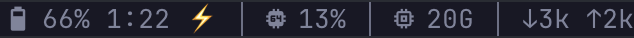

# herdr-macos-statusbar

A [herdr](https://herdr.dev) plugin that puts an iTerm2-style status bar in the tab bar on macOS. The same segments also work in the Herdr desktop app's status bar (see [Herdr app](#herdr-app)):



The icons are Nerd Font glyphs. Ghostty ships them built in; other terminals need a Nerd Font. With `--text` they become words:

```
BAT 66% 1:22 ⚡ │ CPU 13% │ MEM 20G │ NET ↓3k ↑2k
```

| Segment | Shows | Refresh |
|---|---|---|
| `batt` | charge, time to full or empty when macOS has an estimate, ⚡ while charging; hidden on Macs without a battery | 2 s |
| `cpu` | busy percent | 3 s |
| `mem` | used memory in GiB, as Activity Monitor counts it (app + wired + compressed) | 5 s |
| `net` | download and upload per second on the default-route interface, in k or M (bytes) | 3 s |

### Options

Each segment is a separate entry in `config.toml`. To change how one looks, add flags after its name in the `command` string, then run `herdr server reload-config`:

| Flag | Effect |
|---|---|
| `--graph` | Adds a sparkline of the last 6 samples. `cpu` is scaled to 0–100%, `mem` to total RAM, and `net` (download) to the busiest of those samples, with a 10 kB/s floor. It does nothing for `batt`. |
| `--text` | Shows `BAT`, `CPU`, `MEM`, `NET` in place of the icons. Use it if you prefer words, or if your font is missing the icons. |

```toml
{ type = "command", command = "'…/statusbar.sh' cpu --graph --text", interval_seconds = 3, timeout_seconds = 5 }, # macos-statusbar:cpu
```

```
BAT 66% 1:22 ⚡ │ CPU 13% ▂▁▁▃▃▂ │ MEM 20G ▇▇▇▇▇▇ │ NET ↓3k ↑2k ▁▁▂▁▁▂
```

It uses only tools that ship with macOS (`pmset`, `top`, `vm_stat`, `netstat`, `route`) and the system `/bin/bash`, so there is nothing else to install.

## Install

Requires herdr 0.9.5 or newer.

```sh
herdr plugin install tomajask/herdr-macos-statusbar
herdr plugin action invoke configure --plugin tomajask.macos-statusbar
```

`configure` does this:

1. It copies the segment script to `~/.local/state/herdr/plugins/tomajask.macos-statusbar/bin/`. The script needs that fixed path because `herdr plugin update` replaces the plugin checkout.
2. It backs up `config.toml` to `backups/` in the same directory.
3. It adds the four segments at the start of `ui.tab_bar_right`, so whatever you already have there, such as a clock, stays on the right.
   If you haven't set `tab_bar_right_separator`, it also sets it to `" │ "`. That separator applies to every entry in the tab bar, not only these four.
4. It runs `herdr server reload-config`. If herdr rejects the new config, the backup is restored.

You can run `configure` again safely: it only adds segments that are missing. Each entry carries a `# macos-statusbar:<segment>` comment, and `configure` never rewrites a line that has one, so flags you add are kept. To reorder or drop a segment, edit or delete its line in `config.toml`. If you run `configure` again later, the deleted segments come back.

`configure` refuses to edit layouts it cannot change safely, such as a one-line `tab_bar_right = [...]` that already has entries, or `ui` written as dotted keys. In that case it prints why and leaves the file alone. Add the entries yourself, using a line `configure` would write:

```toml
[ui]
tab_bar_right = [
  { type = "command", command = "'/Users/you/.local/state/herdr/plugins/tomajask.macos-statusbar/bin/statusbar.sh' cpu", interval_seconds = 3, timeout_seconds = 5 },
]
```

After `herdr plugin update`, the copied script is refreshed the next time the herdr server starts.

## Herdr app

The Herdr desktop app (`herdr-app`, tested with 0.1.12) doesn't read `config.toml`, so `configure` doesn't reach it. Its window is drawn by JavaScript mods in `~/.config/herdr-app`, and a mod can run `statusbar.sh` and show what it prints. This works because the segments are plain stdout.

1. Get the script: `configure` already installed it at `~/.local/state/herdr/plugins/tomajask.macos-statusbar/bin/statusbar.sh`. Without the TUI, copy `bin/statusbar.sh` anywhere you like; it keeps its history in a `state/` folder next to its own `bin/`.
2. Herdr's own layouts and mods are read-only, so clone the status bar and the layout that shows it:

   ```sh
   herdr-app do mod.clone '{"name":"workspace-status","as":"my-status"}'
   herdr-app do layout.clone '{"name":"main","as":"my-main"}'
   ```

3. In `~/.config/herdr-app/layouts/my-main.json`, change the `status` block's `"mod": "workspace-status"` to `"mod": "my-status"`.
4. In `~/.config/herdr-app/mods/my-status/main.js`, add `exec` to the `herdr` import, then poll each segment on a timer:

   ```js
   const STATUSBAR = "/Users/you/.local/state/herdr/plugins/tomajask.macos-statusbar/bin/statusbar.sh";
   const SEGMENTS = [
     { key: "batt", every: 2000 },
     { key: "cpu", every: 3000, args: ["--graph"] },
     { key: "mem", every: 5000, args: ["--graph"] },
     { key: "net", every: 3000, args: ["--graph"] },
   ];

   // inside the class
   init(_props, cx) {
     this.seg = {};
     for (const s of SEGMENTS) {
       cx.timer.every(s.every, (cx) => this.refresh(s, cx));
       this.refresh(s, cx);
     }
   }

   refresh(s, cx) {
     cx.spawn(async (cx) => {
       const r = await exec(STATUSBAR, [s.key, ...(s.args ?? [])]).catch(() => null);
       const text = r && r.code === 0 ? r.stdout.trim() : "";
       if (text !== this.seg[s.key]) { this.seg[s.key] = text; cx.notify(); }
     });
   }
   ```

5. In `render()`, put the segments before the palette hint:

   ```js
   .children(SEGMENTS.filter((s) => this.seg[s.key])
     .map((s) => div().id(`seg-${s.key}`).text_color(t.muted).child(this.seg[s.key])))
   ```

6. Run `herdr-app check ~/.config/herdr-app/mods/my-status`, then `herdr-app status` and look for an empty `errors` list. The app reloads the mod on save.

The flags work the same as in the TUI. Clones are yours, so Herdr app updates don't change them.

## Uninstall

```sh
herdr plugin action invoke unconfigure --plugin tomajask.macos-statusbar
herdr plugin uninstall tomajask.macos-statusbar
```

`unconfigure` removes the marked lines, including the separator it set, and leaves the `tab_bar_right` array in place, which may now be empty.

## Notes

- herdr runs status commands on the server. With `herdr --remote`, the segments show the remote machine, and they stay hidden if that machine is not a Mac.
- CPU sampling takes about 2 s (`top` needs two samples), which is why every entry has `timeout_seconds = 5`.
- Network rates come from two `netstat` readings taken 1 s apart. On a VPN, the default route is the tunnel interface, so traffic is not counted twice.

## Development

```sh
brew install bats-core shellcheck
bats test/
shellcheck bin/*.sh
herdr plugin link .
bin/preview.sh --graph   # the bar as herdr shows it, with its length
```

The tests feed raw output from the macOS tools into each segment (see `test/fixtures/README.md` for which samples are real captures), and feed sample `config.toml` files into the config editor.

## License

MIT
